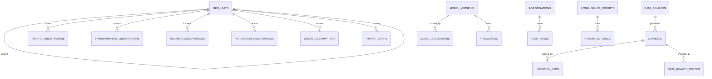

# Entity relationships

Primary keys are UUIDs on registry tables and integers on observation tables. Natural deduplication uses `(dataset_code, source_row_id)`. Spatial columns live in the PostGIS migration rather than the portable ORM, because SQLite has no geometry type. Time columns are indexed on traffic, environment, weather, waste, and ridership.

Crime incidents intentionally have no demographic columns. Population rows carry `metric_kind` so a 2010 count cannot be confused with an ACS estimate.
