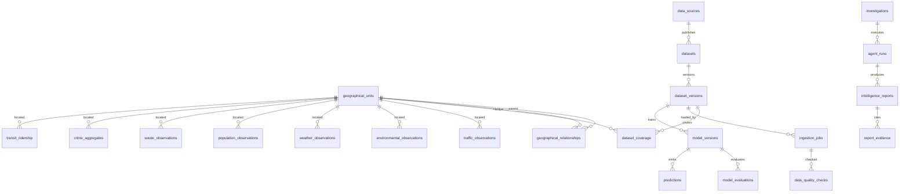

# Database design

PostgreSQL with PostGIS is the system of record for validated facts, geography, model metadata, and agent evidence. Raw provider files stay outside the normalised tables. One schema serves every city. `city_id` is not copied onto every table when `geographical_unit_id` already places the row.

This is the proposed design for review. It is not an applied migration.

## Design rules

- Primary keys are UUIDs generated by the database.
- Source natural keys are unique inside a dataset version, not globally.
- Geometries use SRID 4326.
- Timestamps are `timestamptz`.
- Facts reference `dataset_version_id`.
- Null means missing. A check constraint can forbid a sentinel where a domain truly cannot contain a negative, without turning null into zero.
- Predictions do not enter observation tables.
- Complaint-level rows, if retained, live in a `restricted` schema. The API role cannot read it. Public queries use `crime_aggregates`.
- `ownername` from PLUTO is not loaded into the public building or lot tables.

## Core relationships

## Geography

### `geographical_units`

| Column | Type | Notes |
| --- | --- | --- |
| `id` | uuid pk | |
| `unit_type` | text | continent, country, admin_region, metro, city, district, neighbourhood, grid_cell, monitoring_location |
| `subtype` | text | borough, community_district, nta, epa_monitor, subway_complex, and others |
| `name` | text | |
| `code` | text | Local code such as `BK0101` or `88101-site` |
| `iso_code` | text | Country or subdivision when applicable |
| `source` | text | |
| `source_id` | text | |
| `valid_from`, `valid_to` | date | Boundary vintage |
| `geom` | geometry(Geometry, 4326) | Polygon, multipolygon, line, or point |
| `centroid` | geometry(Point, 4326) | |
| `h3_index` | text | Only for cells generated by URBIX |
| `h3_resolution` | smallint | |
| `attributes` | jsonb | Publisher fields that are not first-class |

Unique `(source, source_id, valid_from)`.

### `geographical_relationships`

| Column | Type | Notes |
| --- | --- | --- |
| `id` | uuid pk | |
| `parent_id` | uuid fk | |
| `child_id` | uuid fk | |
| `relationship_type` | text | contains, statistical_parent, approximates, overlaps |
| `coverage_note` | text | Required for known exceptions such as Marble Hill and Rikers |
| `dataset_version_id` | uuid fk | Boundary vintage that asserted the link |

A unit may have several parents of different types. Queries state which relationship they use.

### `geographical_aliases`

`unit_id`, `alias`, `alias_type` (`official`, `common`, `historical`). Used by search. A common name is not treated as an official boundary.

## Data management

### `data_sources`

`id`, `name`, `publisher`, `homepage_url`, `terms_url`, `licence_name`, `licence_url`, `attribution_text`, `commercial_use` (`allowed`, `non_commercial_api`, `unknown`), `retrieved_at`.

### `datasets`

`id`, `data_source_id`, `name`, `domain`, `external_id`, `endpoint_url`, `format`, `spatial_grain`, `temporal_grain`, `description`, `limitations`.

### `dataset_versions`

`id`, `dataset_id`, `version_label`, `retrieved_at`, `raw_uri`, `checksum`, `temporal_start`, `temporal_end`, `status` (`landed`, `validated`, `ready`, `retired`), `methodology_note`.

### `dataset_coverage`

`id`, `dataset_version_id`, `geographical_unit_id`, `status` (`available`, `partial`, `historical_only`, `unavailable`), `spatial_grain`, `temporal_grain`, `coverage_start`, `coverage_end`, `limitation`.

The city page reads this table before it reads facts.

### `ingestion_jobs`

`id`, `dataset_version_id`, `started_at`, `finished_at`, `status`, `watermark`, `rows_read`, `rows_written`, `error`.

### `data_quality_checks`

`id`, `ingestion_job_id`, `check_name`, `severity`, `passed`, `observed_value`, `detail`.

Examples: impossible year, null geometry, duplicate complaint number, speed status meaning missing, organics null rate, unmatched community district.

## Observations

Shared columns, implemented on each fact table rather than through one universal fact table:

`id`, `dataset_version_id`, `geographical_unit_id`, `observed_at`, `observed_end`, `geom`, `h3_r8`, `h3_r9`, `variable_code`, `value`, `unit`, `quality_flag`, `source_record_id`, `attributes`.

`quality_flag` includes `measured`, `estimated_by_publisher`, `interpolated_by_urbix`, `missing`, and `suppressed`.

### Domain tables

| Table | Grain | Notes |
| --- | --- | --- |
| `traffic_observations` | ATR segment and 15-minute bin | `value` is vehicle count. Segment id stays in attributes. |
| `traffic_speed_snapshots` | Link and archive time | `observed_at` is `data_as_of`. `ingested_at` is when URBIX stored the snapshot. Status `-101` becomes `quality_flag = missing` and a null speed. |
| `environmental_observations` | Monitor and hour or day, or NTA/CD and season or year | `variable_code` such as `pm25`, `pm10`, `no2`, `co`, `o3`. Publisher grain is mandatory. |
| `weather_observations` | Open-Meteo grid cell and hour | Store requested coordinate, returned grid centre, and elevation. |
| `population_observations` | Unit and vintage | `estimate_type`: `census`, `survey`, `projection`, `gridded_model`. Projections and WorldPop cannot use `census`. |
| `waste_observations` | Community district and month | One row per material variable, or typed columns for the stable DSNY fields. Typed columns are preferred because the schema is stable: refuse, paper, MGP, and organics streams. Null organics stay null. |
| `crime_aggregates` | Precinct, NTA, or H3, by period and offence class | Counts only. Suppression when the count is below a stated threshold is a product rule to set before display. |
| `collision_observations` | Crash | Injury counts may be zero. Missing coordinates stay null. |
| `transit_ridership` | Complex, hour, fare class | Store fare class. Published totals must sum a declared set of classes. |

`restricted.crime_complaints` may hold the validated complaint key, time, offence class, precinct, and a snapped H3 cell for audit. It does not hold suspect or victim demographics. Exact coordinates are omitted unless a later privacy review decides a restricted research role may see them. The default is not to retain exact complaint coordinates after aggregation.

## Infrastructure

| Table | Keys and geometry | Notes |
| --- | --- | --- |
| `buildings` | `bin` unique per dataset version, polygon, `bbl`, `height_roof`, `construction_year` | From footprints. |
| `tax_lots` | `bbl` unique per PLUTO version, point or lot geometry, land use, areas, `unitsres`, `yearbuilt` | No owner name. |
| `transit_stops` | GTFS stop id, point, ADA flags, parent complex | |
| `transit_routes` | route id, agency, mode, geometry | |
| `transit_stop_times` | optional, large | Load only if frequency metrics cannot be derived from trips and frequencies. |
| `public_facilities` | OSM or official points | Empty until a connector is verified. |

Road centre-lines wait for either a tested LION extract or a bounded OSM extract. The table `road_segments` is reserved with `source`, `source_id`, `geom`, `name`, and `attributes`, and is not created until that connector test passes. Creating an empty unused table is less useful than adding it in the migration that loads it.

## Machine learning

### `model_registry`

`id`, `name`, `domain`, `target`, `horizon`, `geographical_grain`.

### `model_versions`

`id`, `model_id`, `mlflow_run_id`, `dataset_version_id`, `feature_spec`, `trained_at`, `status` (`candidate`, `promoted`, `rejected`, `retired`).

### `model_evaluations`

`id`, `model_version_id`, `baseline_name`, `split_start`, `split_end`, `metric_name`, `metric_value`, `baseline_value`. Metrics are written by the evaluation job. No seed data.

### `predictions`

`id`, `model_version_id`, `geographical_unit_id`, `issued_at`, `target_start`, `target_end`, `value`, `lower`, `upper`, `unit`. A prediction without an evaluation on that version is not returned by the public API.

## AI and operations

| Table | Purpose |
| --- | --- |
| `investigations` | Question, resolved unit, time range, status |
| `agent_runs` | Graph state, model provider name, token counts, error |
| `agent_tool_calls` | Tool name, validated arguments, result hash, dataset versions touched |
| `intelligence_reports` | Structured sections plus the prose |
| `report_evidence` | Tool payload fragments the prose is allowed to cite |
| `knowledge_documents` | Dataset cards, methodology, model cards |
| `knowledge_chunks` | Text, citation, `embedding vector` via pgvector |
| `anomalies` | Series, time, score, detector version, threshold. A detector version is an entry in `model_versions` or a named statistical rule. |
| `alerts` | Human-visible anomaly or data-quality event. Empty until alerting exists. |
| `system_logs` | Job and API errors worth retaining beyond container logs |

The embedding dimension is a migration choice tied to the selected embedding model. It is not fixed to a vendor in this design.

## Indexing

- GiST on every `geom`.
- B-tree on `(dataset_version_id, geographical_unit_id, observed_at)` for each fact table.
- BRIN on `observed_at` for large append-only facts such as ridership, speed snapshots, and hourly pollution.
- B-tree on `h3_r8` and `h3_r9`.
- Unique `(dataset_version_id, source_record_id)` where the publisher provides a stable id.
- Unique waste key `(dataset_version_id, geographical_unit_id, observed_at)`.
- Unique ridership key `(dataset_version_id, geographical_unit_id, observed_at, fare_class)`.
- GIN on `attributes` only where a connector proves a filter needs it. Not by default.
- GiST or operator index on `knowledge_chunks.embedding` after the vector dimension is chosen.

## What is deliberately absent

- A table per city.
- A table per indicator.
- User-level location history.
- Suspect, victim, or owner-identity tables.
- A column of fabricated “live index” scores.
- Seeded metrics or seed observations. Geography seeds are real boundaries. Demo rows, if ever needed for a layout test, live in a fixture and cannot be marked `ready`.
