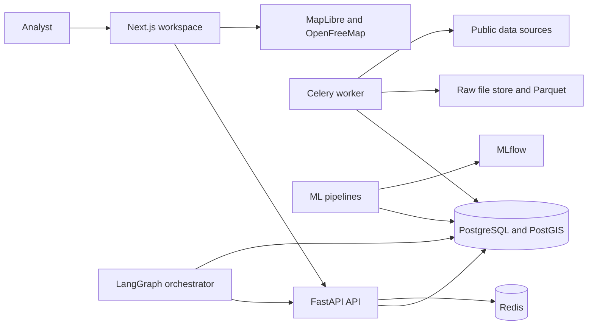

# System architecture

URBIX is a modular monolith. The first deployment is one repository, one database, one API, one worker, and one web application. Separate Python packages keep ingestion, machine learning, and agents from leaking into route handlers. A service is split out only when a measured load or a security boundary requires it.

## System context

The browser never holds provider credentials. It calls URBIX. The worker calls NYC Open Data, data.ny.gov, EPA, Open-Meteo, MTA, geoBoundaries, and later OSM. MTA terms require that cached GTFS and any future real-time feed be served from URBIX, not proxied per request to MTA.

## Packages

| Package | Responsibility |
| --- | --- |
| `frontend` | Workspace, map, charts, investigation UI. No analytical invention. |
| `backend` | Versioned API, auth, query services, coverage rules. |
| `data-engine` | Connectors, validation, normalisation, incremental loads. |
| `ml-engine` | Training, evaluation, registry, prediction jobs. |
| `ai-engine` | Orchestrator, tools, RAG, report assembly. |
| `database` | Alembic migrations, seeds, ER source. |

`backend` imports service functions from the other Python packages. API routes validate input, check coverage, call a service, and shape the response.

## Geographical model

Administrative depth differs by country. NYC also breaks a strict tree: community-district tabulation areas contain neighbourhood tabulation areas, while boroughs, charter community districts, and census tracts overlap those units in ways the publisher documents.

The source of truth is:

- `geographical_units`, one row for any place URBIX can name.
- `geographical_relationships`, typed links such as `contains`, `statistical_parent`, `approximates`, and `overlaps`.
- `dataset_coverage`, the status of a dataset for a unit.

A unit has a type (`continent`, `country`, `admin_region`, `metro`, `city`, `district`, `neighbourhood`, `grid_cell`, `monitoring_location`) and a free subtype (`borough`, `community_district`, `cdta`, `nta`, `census_tract`, `subway_complex`, `atr_segment`, `epa_monitor`). New cities add units and relationships. They do not add tables.

H3 cells are grid units generated by URBIX. Their resolution is stored on the unit. A dataset is aggregated to an H3 resolution only when that transformation is recorded on the dataset version. Traffic segments, NTAs, and EPA monitors are not forced into one cell size for storage. Aggregation is a query or a materialised product.

## Data flow

1. A connector reads one external dataset and writes an immutable raw file. The file checksum, URL, retrieval time, and licence snapshot go on the ingestion job.
2. Validation records row counts, null rates, geometry failures, impossible timestamps, and duplicate keys. It does not delete the raw file.
3. Transformation maps source fields into a domain table and resolves geography. Unmatched locations stay unmatched and are counted. They are not dropped silently and not given a city-centre coordinate.
4. The dataset version is marked ready. Coverage rows say `available`, `partial`, `historical_only`, or `unavailable`, with a start time, end time, and spatial grain.
5. Analytical services read ready versions only. The API returns the version id, source, grain, and time range with the numbers.
6. ML jobs read ready versions, write evaluations and predictions, and never update the observation that was predicted.
7. Agent tools call those services. The report stores the tool outputs as evidence and the prose separately.

Incremental loads use a source watermark when one exists: DSNY month, collision date, complaint report date, ridership timestamp, and the last archived speed snapshot. Full reloads are reserved for boundary releases and PLUTO versions.

## Processing choices

- PostGIS stores geometries, spatial joins, buffers, and the analytical facts.
- GeoPandas and Shapely run in the worker for boundary repair, joins that are awkward in SQL, and file-to-PostGIS loads.
- OSMnx is limited to bounded extracts, such as a walk network around subway stops. It is not pointed at an unbounded city download on the first run.
- Polars and DuckDB profile large CSV and Parquet files before they enter PostGIS.
- Parquet is the analytical copy of large raw extracts. It is not a second system of record for facts that have passed validation.
- H3 is used for comparable hotspot grids and for map tiles of dense points. The native geometry remains stored.

## Machine-learning workflow

Training is a worker job, not a request handler.

1. Extract a frozen dataset version.
2. Validate time order, keys, and leakage rules.
3. Build features in a versioned function.
4. Fit a baseline and one or more candidate models.
5. Evaluate with a chronological split or rolling origin.
6. Log parameters, data version, and metrics to MLflow.
7. Register a model only if it beats the baseline on the held-out period by a predeclared margin, or if the comparison is stored and the model is marked as not promoted.
8. Prediction jobs write interval and point outputs where the model supports them, with the model version and the horizon.

The first promoted problems are hourly subway ridership, monthly waste tonnage, and monitor-level PM2.5. Specification is in the ML strategy.

## AI workflow

The orchestrator is a graph with a small number of nodes.

1. Interpret the question into a structured plan: place, time, domain, and operation.
2. Resolve the place against `geographical_units`. If resolution is ambiguous, ask. If the place is outside loaded coverage, stop.
3. Read coverage. If the domain is unavailable, the answer says so.
4. Call deterministic tools for observations, comparisons, spatial aggregates, and predictions.
5. Retrieve methodology passages from the knowledge index when the question is about meaning or method.
6. Draft an answer that keeps observations, statistical associations, predictions, and hypotheses in separate sections.
7. Run a numeric check: every figure in the draft must occur in the tool payload.

The model provider is selected by configuration. Keys stay in the server environment.

## Geospatial workflow

Map layers are registered rows, not files dropped into the frontend.

- A layer has a dataset version, a geometry type, a min and max zoom, a simplification tolerance, and a coverage status.
- Boundary layers read PostGIS and can be served as GeoJSON while they are small.
- Building footprints are served as vector tiles generated from PostGIS. The browser does not download the city as one document.
- Point observations are aggregated to H3 or to an administrative unit before display. Complaint points are not a default layer.
- The time control filters layers whose grain supports it. An annual air indicator does not pretend to move when the clock is set to an hour.
- Tooltips show value, unit, time, source, and grain.

## Integration rules

- Connectors are city-aware only through configuration: endpoint, geographical filter, field map, and schedule. NYC field names live in the NYC connector, not in the API.
- A connector that has not passed a retrieval test cannot be marked ready. Catalogue records in the inventory are not the same thing as a parsed feed. GTFS is the main example.
- Secrets (`NYC_OPENDATA_APP_TOKEN`, `CENSUS_API_KEY`, `OPENAQ_API_KEY`, `OPEN_METEO_API_KEY`, LLM keys) are environment variables. The frontend receives none of them.
- Rate limits and provider terms are connector properties. MTA cache rule and Open-Meteo non-commercial free tier are enforced in configuration, not in a comment.
- Time is stored in UTC, with the source zone and the source local timestamp retained when the publisher uses local civil time. NYC observations are interpreted in `America/New_York`, including daylight-saving transitions. Open-Meteo’s warning that a named timezone does not rewrite timestamps across a DST change is recorded on the weather dataset version.

## Request path for a city indicator

`GET /api/v1/cities/{id}/indicators?domain=waste&from=2024-01-01&to=2024-12-31`

1. Resolve the city unit.
2. Find the ready waste dataset version and its coverage.
3. If coverage is missing, return a typed empty payload with status `unavailable`. Do not return zeros.
4. Aggregate `waste_observations` for child units related by `contains` or the dataset’s declared geography.
5. Attach source, version, grain, and the quality summary.

The same contract is used by the page and by the agent. There is one implementation.

## Deployment shape for Phase 2

Docker Compose runs PostGIS, Redis, the API, the worker, MLflow, and the frontend. Object storage can be a mounted volume until a second city or a large PLUTO reload makes S3-compatible storage worth adding. Celery is justified immediately because ingestion and training must not run inside a web request. It is one worker process, not a distributed platform.

Authentication can wait until the API is no longer local. The first shared deployment needs an authenticated admin for connector runs and a read-only analyst role for the agent. That is Phase 9 work pulled forward only if the app is exposed beyond localhost.
