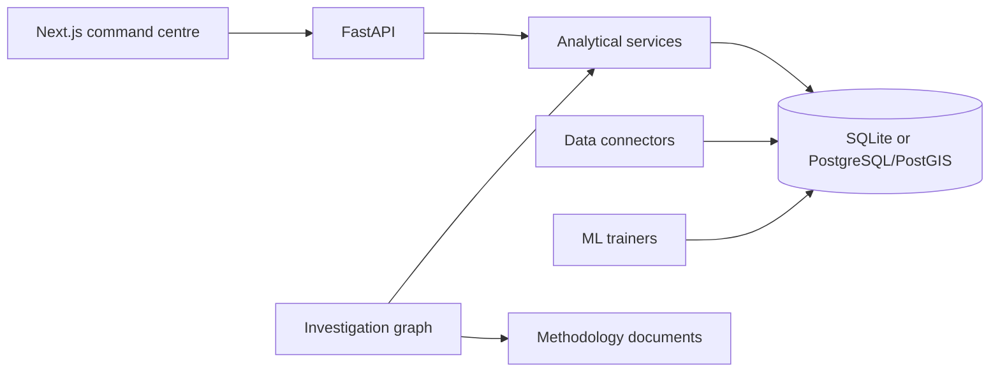

# Architecture

URBIX is a modular monolith.

Connectors fetch, validate, and normalize. Services are the only path that turns rows into indicators. The investigation graph may choose tools, but it cannot execute arbitrary SQL. A deterministic composer writes the answer from tool output, and a number check rejects prose that introduces a figure the tools did not return.

## Geographical model

`geo_units.parent_id` is the hierarchy. Levels are data, not separate city-specific tables: global, continent, country, admin region, metro, city, district, neighbourhood. Boroughs, community districts, CDTAs, and NTAs are districts or neighbourhoods distinguished by `properties.kind`.

Boundaries are GeoJSON. On PostgreSQL, `001_postgis.sql` adds geometry columns and GIST indexes, and `sync_postgis_geometries` fills them. Shapely answers point-in-polygon and geodetic area in both runtimes.

## Machine learning

Each trainer uses a chronological train, validation, and test split. The validation fold chooses among histogram gradient boosting, XGBoost, and LightGBM when those libraries import. The test fold is scored once. A persistence or train-mean baseline is stored beside every metric. Short series produce a `withheld` model with null metrics.

Supported horizons:

- Weather and CAMS PM2.5: 24 hours, at the model grid cell.
- DSNY refuse: next month, when enough district-months exist.
- ATR volume: sampled-hour evaluation only.

## AI

The graph is plan, execute, compose. Without an API key the planner is a keyword map onto the tool registry. With a key, an OpenAI-compatible JSON call may choose tools and is rejected if it names an unknown tool. Reports are assembled from KPIs and do not call a language model.

## Deployment

Docker Compose runs PostGIS, the API, and the web app. Redis, Celery, and a separate vector database are not required for the current volume. Ingestion runs in-process and records an `ingestion_jobs` row.
